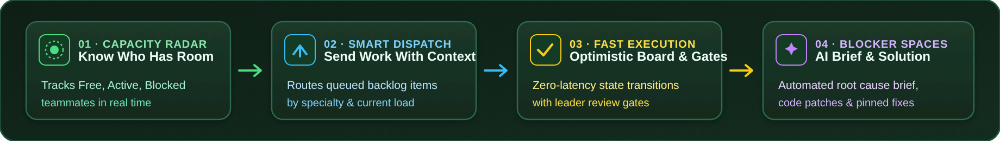
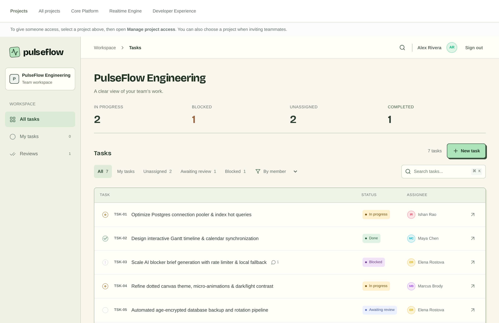
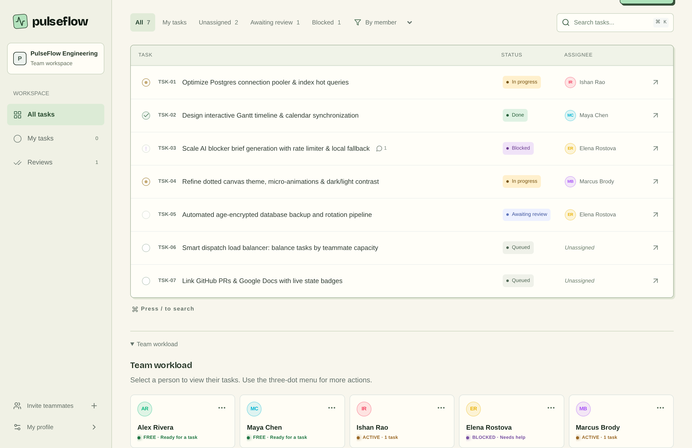
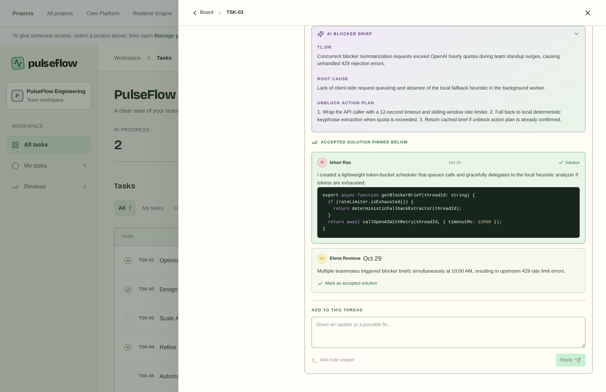
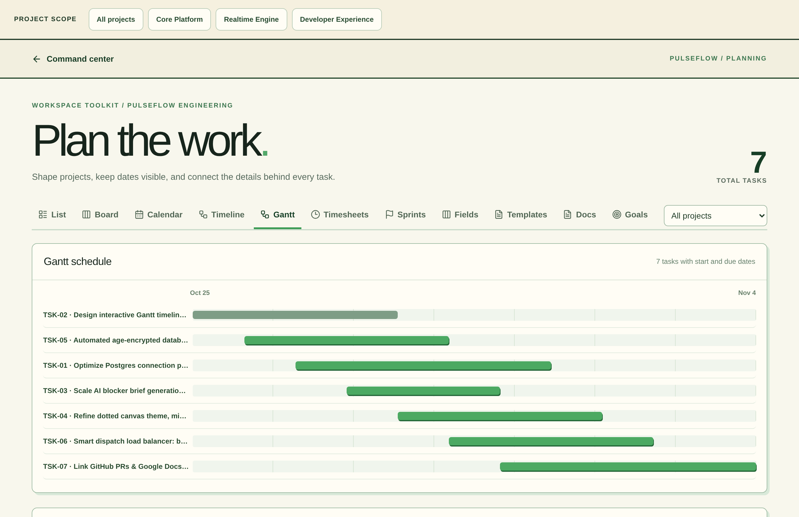

<div align="center">


<br/><br/>

[](https://nextjs.org/)
[](https://react.dev/)
[](https://www.typescriptlang.org/)
[](https://www.postgresql.org/)
[](https://www.prisma.io/)
[](https://www.docker.com/)

<p align="center">
  <b>Self-hosted team task board with live capacity, smart dispatch, and focused blocker threads.</b><br/>
  Eliminates coordination drag by pairing real-time bandwidth signals with AI-assisted problem resolution.
</p>

[Quickstart](#-quickstart) • [Visual Tour](#-visual-tour) • [Workflow](#-workflow-lifecycle) • [Planning Suite](#-planning-suite) • [Docker](#-portable-docker-deployment) • [Contributing](#-contributing)

</div>

---

## ⚡ Workflow Lifecycle

PulseFlow pairs live capacity with context-aware dispatch, optimistic state updates, and isolated blocker resolution:

<div align="center">
  
</div>

1. **Capacity Radar**: Tracks real-time member workload (*Free*, *Active*, *Blocked*, *Overloaded*) before tasks land.
2. **Smart Dispatch**: Evaluates specialty and bandwidth to route queued backlog items to available teammates.
3. **Fast Execution**: Optimistic Kanban transitions, task checklists, and role-based review gates.
4. **Blocker Spaces**: Isolates impediments into dedicated threads with automated AI root-cause summaries and pinned code fixes.

---

## 📸 Visual Tour

<div align="center">
  <table>
    <tr>
      <td width="50%">
        <b>Workspace Board & Task Flow</b>
        <br/>
        
      </td>
      <td width="50%">
        <b>Live Capacity Radar</b>
        <br/>
        
      </td>
    </tr>
    <tr>
      <td width="50%">
        <b>Blocker Spaces & AI Brief</b>
        <br/>
        
      </td>
      <td width="50%">
        <b>Gantt Timeline Schedule</b>
        <br/>
        
      </td>
    </tr>
  </table>
</div>

> [!TIP]
> **Deterministic AI Fallback**: Blocker spaces utilize OpenAI when configured, but automatically delegate to an onboard local heuristic extractor when external credentials are absent or rate limits are reached.

---

## 🚀 Quickstart

### Prerequisites
- **Node.js** 22+
- **PostgreSQL** 16+ (Local or cloud PostgreSQL like Neon)

```bash
# 1. Clone repository
git clone https://github.com/Manu-2717/pulseflow.git
cd pulseflow

# 2. Configure environment
cp .env.example .env
# Set DATABASE_URL and a 32+ character BETTER_AUTH_SECRET in .env

# 3. Install & run migrations
npm install
npx prisma migrate deploy

# 4. (Optional) Populate demo workspace
node scripts/seed-demo.mjs

# 5. Start dev server
npm run dev
```

Open [http://localhost:3000](http://localhost:3000) to start. *(Demo credentials: `alex@pulseflow.dev` / `Password12345!`)*

---

## 🗂 Planning Suite (`/w/[slug]/plan`)

Beyond daily task boards, PulseFlow includes a dedicated planning toolkit:

- **Gantt Schedule & Timeline**: Visual duration bars with start/due date tracking.
- **Calendar Synchronization**: One-click Google Calendar integration via standard RFC 5545 links.
- **Sprints & Iterations**: Track sprint goals, task completion, and burndown progress.
- **Custom Fields**: Add `TEXT`, `NUMBER`, `DATE`, or `SELECT` dropdown definitions per workspace.
- **Templates & Recurring Tasks**: Save repeatable task structures and schedule automated recurring work.
- **Team Goals & Timesheets**: Measurable milestones with live progress bars and aggregated weekly time tracking.

---

## 🐳 Portable Docker Deployment

PulseFlow provides a self-contained `Dockerfile` and `docker-compose.yml`:

```bash
cp .env.example .env
docker compose up --build -d
```

- **Health Check**: Endpoint `/api/health` validates database connectivity.
- **Isolation**: Runs unprivileged with automatic migration execution prior to web server startup.

---

## ⚙️ Configuration Reference

| Variable | Purpose | Default |
| :--- | :--- | :--- |
| `DATABASE_URL` | PostgreSQL connection string | *Required* |
| `BETTER_AUTH_SECRET` | Session signing secret (32+ chars) | *Required* |
| `BETTER_AUTH_URL` | Application root URL | `http://localhost:3000` |
| `SITE_URL` | Canonical origin for sitemaps | `http://localhost:3000` |
| `OPENAI_API_KEY` | Optional model-generated blocker briefs | *Local fallback* |
| `SMTP_HOST` / `_PORT` | SMTP delivery for verification and recovery | Optional in dev |
| `GOOGLE_CLIENT_ID` / `_SECRET` | Google OAuth credentials | Optional |
| `GITHUB_CLIENT_ID` / `_SECRET` | GitHub OAuth credentials | Optional |
| `APPLE_CLIENT_ID` / `_KEY_ID` | Apple Sign-In credentials | Optional |
| `OIDC_ENABLED` / `OIDC_ISSUER` | Generic OIDC provider (USAR FOSS Club) | Optional |

---

## 🔒 Security & Operations

- **Auth & Access Control**: Powered by [Better Auth](https://www.better-auth.com/) with cryptographically hashed tokens, scoped multi-tenant workspaces, and role enforcement (`LEADER`, `ADMIN`, `MEMBER`, `MENTOR`).
- **Encrypted Backups**: Built-in `scripts/backup-database.mjs` supports `age` asymmetric encryption.
- **Rate Limits**: AI brief requests are protected by sliding-window rate limits (10 req/member/hr, 12s provider timeout).

Detailed runbooks:
- 📖 [Operations Runbook](docs/operations.md)
- 🛡 [Project Access & Authorization](docs/project-access-plan.md)
- 🔑 [OIDC Setup](docs/oidc-login.md)
- ✅ [Task Review Workflow](docs/task-review.md)

---

## 🤝 Contributing

1. Fork the upstream repository: [Manu-2717/pulseflow](https://github.com/Manu-2717/pulseflow)
2. Clone your personal fork: `git clone https://github.com/YOUR_USERNAME/pulseflow.git`
3. Create your feature branch: `git checkout -b feature/my-feature`
4. Commit your changes: `git commit -m "feat: add capability"`
5. Push to your fork: `git push origin feature/my-feature`
6. Open a Pull Request against `Manu-2717/pulseflow:main`.

---

<div align="center">

**PulseFlow** • Built for the work between the work.

✳ *Small steps, clearer days.*

</div>
